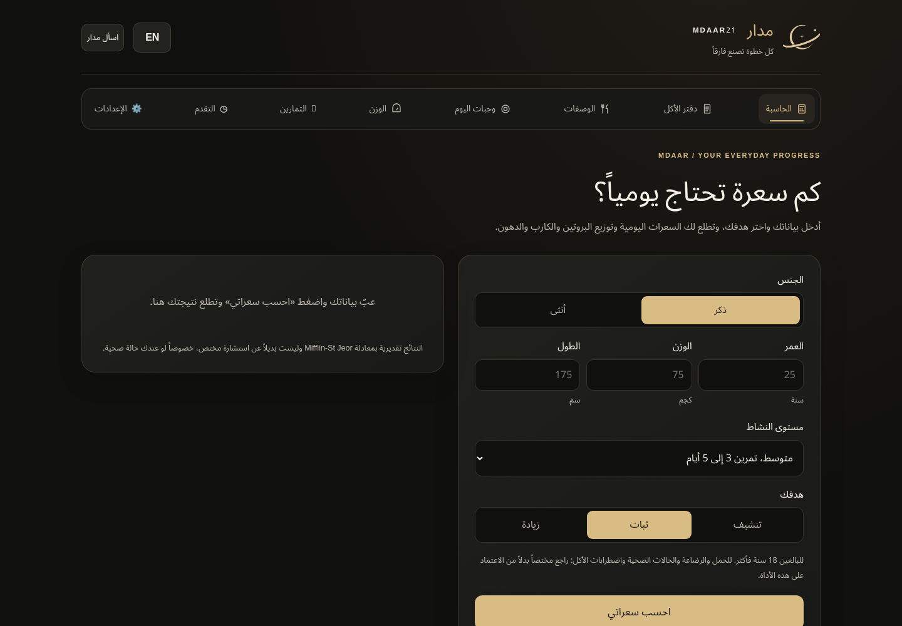
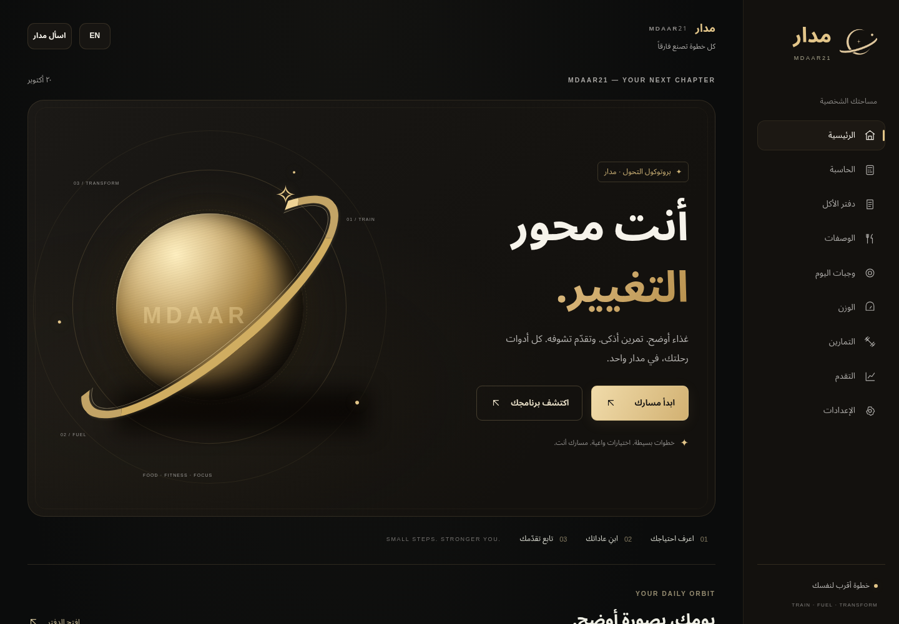
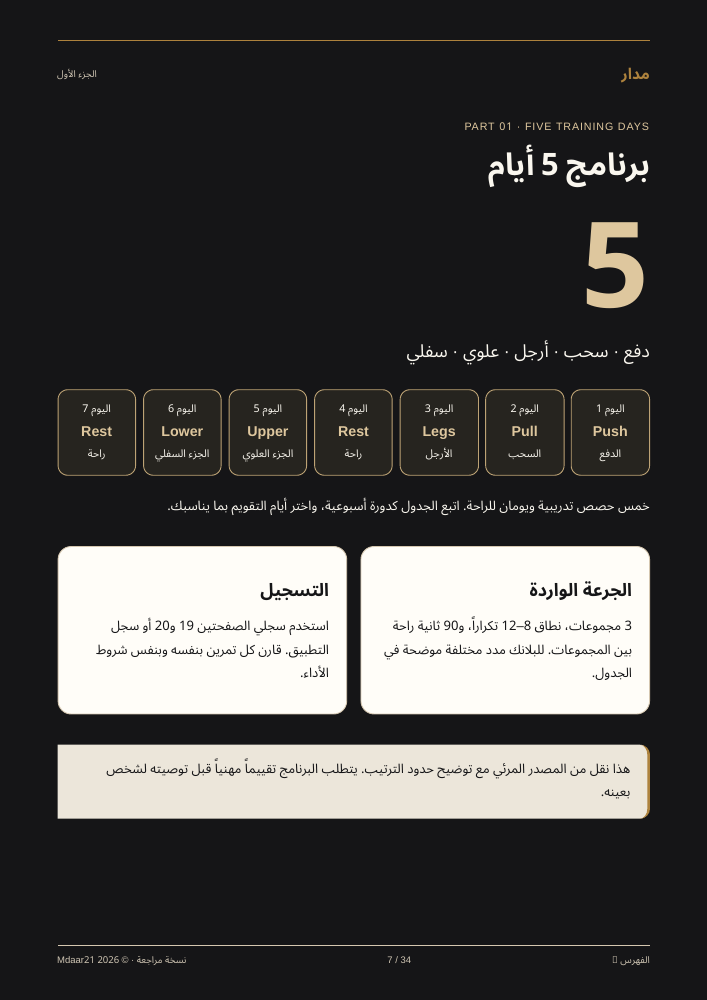
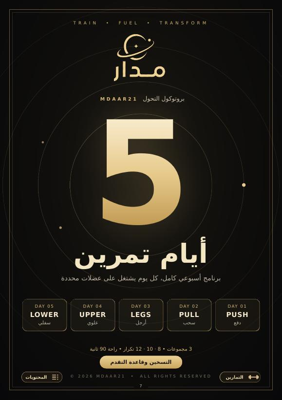
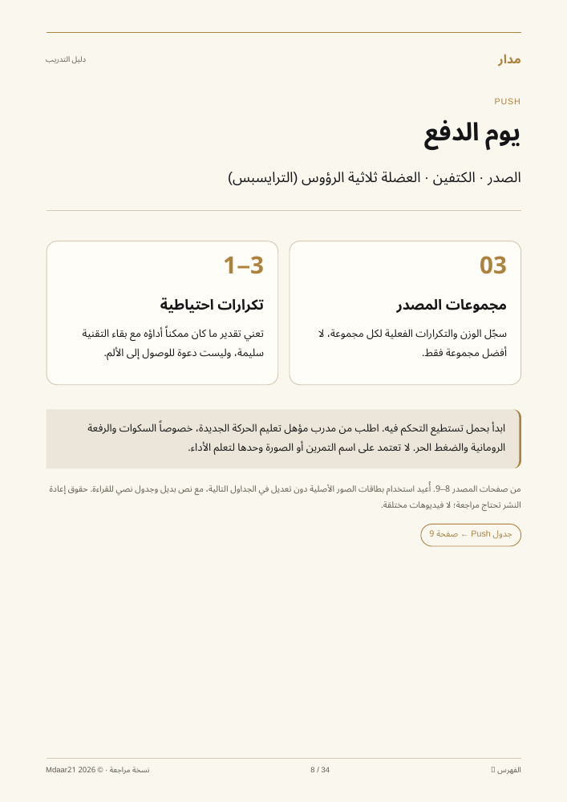
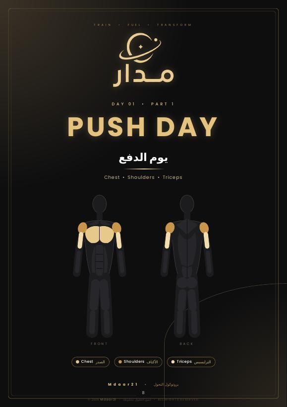
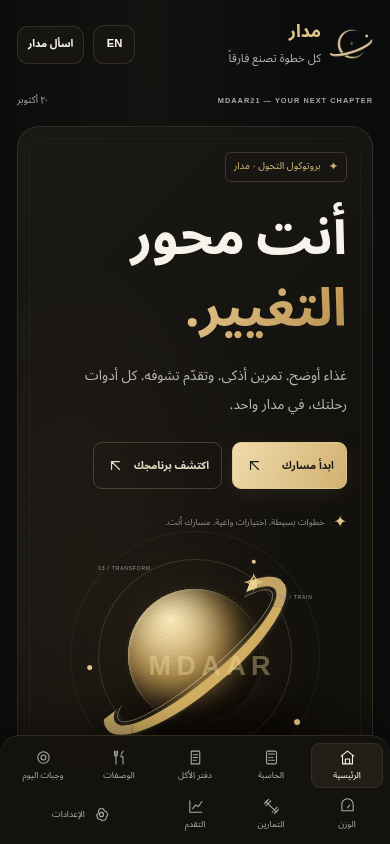
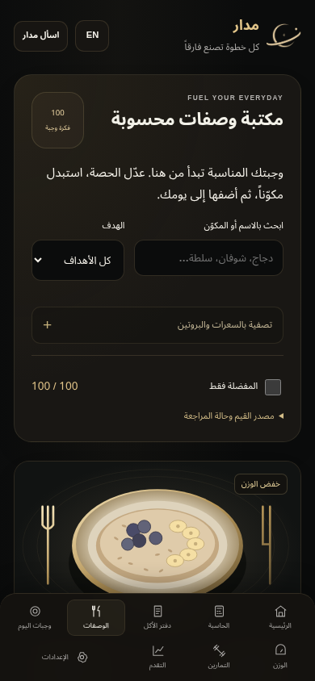
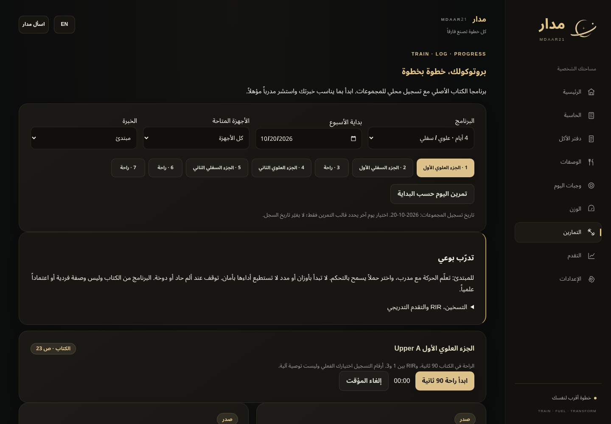

# مدار — التصميم الجديد بهويته الأصلية

هذه صور فعلية من النسخة الجديدة، وليست تصوراً مقترحاً. اعتمدت الهوية التي حددها المالك: شعار مدار الأصلي، الأسود الدافئ، الذهبي، والتكوينات المدارية وأغلفة البرامج الأصلية.

**رابط Netlify القديم لا يعرض هذه النسخة بعد.** التغييرات على فرع `codex/mdaar-global-upgrade` للمراجعة، ولم ينفذ هذا العمل نشر الموقع أو دمج main.

[افتح ملف الكتاب الجديد — هوية مدار الأصلية v2](../../artifacts/mdaar-protocol-original-identity-v2.pdf). حجمه 15.8 ميغابايت،34 صفحة. في صفحة GitHub اضغط زر **Download raw** للتنزيل. لا تستخدم رابط الملف في commit القديم عند مراجعة هذه الطبعة.

## الموقع: قبل وبعد

| الواجهة السابقة | الرئيسية الجديدة |
| --- | --- |
|  |  |

الرئيسية الجديدة تضم عرضاً بصرياً مدارياً، وتنقلاً جانبياً على الكمبيوتر، ولوحة يومية تعتمد على سجل المستخدم، واختصارات للأدوات، وأغلفة البرامج الأصلية. بقيت الحاسبة والدفتر والتدريب والوصفات والمفضلة والخصوصية متاحة، وصارت الوصفات الأصلية داخل قسم مستقل قابل للفتح.

## أغلفة البرامج

| النسخة السابقة | بعد استعادة الغلاف الأصلي |
| --- | --- |
|  |  |

## أغلفة أيام التمرين

| النسخة السابقة | بعد استعادة الغلاف الأصلي |
| --- | --- |
|  |  |

استعيدت 11 صفحة غلاف للكتاب والبرامج والدفع والسحب والعلوي والسفلي. بقيت الرسوم الأصلية والشعار، وأصبحت صفحات المحتوى سوداء وذهبية متسقة معها، وسجلات الكتابة عاجية. النصوص والبرامج لم تتغير اعتباطياً أثناء العمل البصري.

## الجوال والأدوات

| الرئيسية على الجوال | الوصفات على الجوال |
| --- | --- |
|  |  |

## التحقق

نجح 53 اختبار وحدة وتكامل، و 31 حالة متصفح، وفحص وصول آلي لتسعة أقسام ونافذة المساعد دون مخالفات آلية. أحجام العرض:320 و 390 و 768 و 1440. راجع [تقرير التصميم والاختبار](../design-qa.md). لم يُختبر الموقع المنشور أو Groq/Redis مباشرةً؛ تفعيل AI والمراجعات المتخصصة والمتطلبات الخارجية الموثقة سابقاً ما زالت مستقلة عن هذا التحديث البصري.
